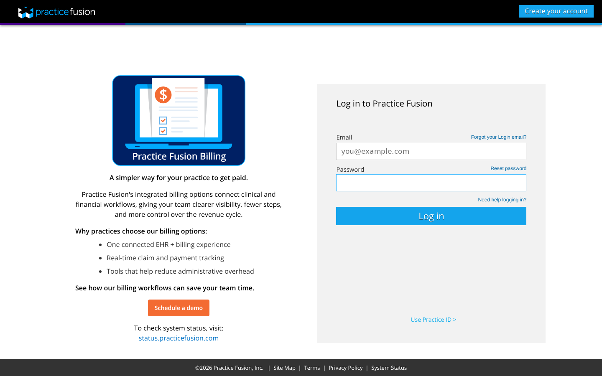
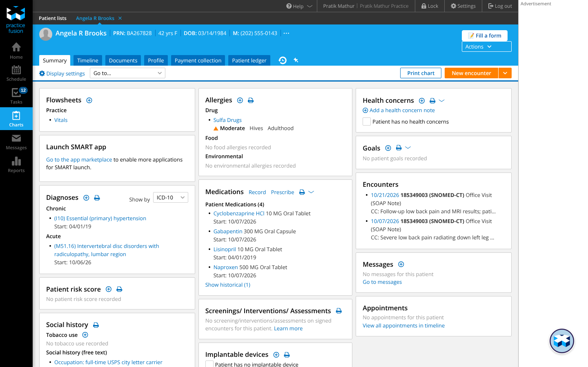
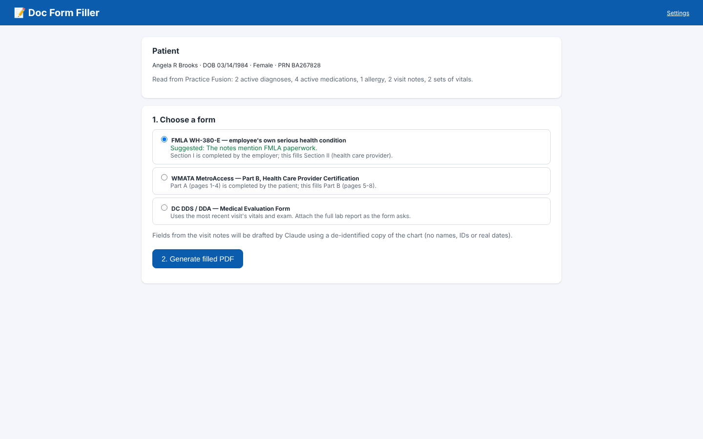
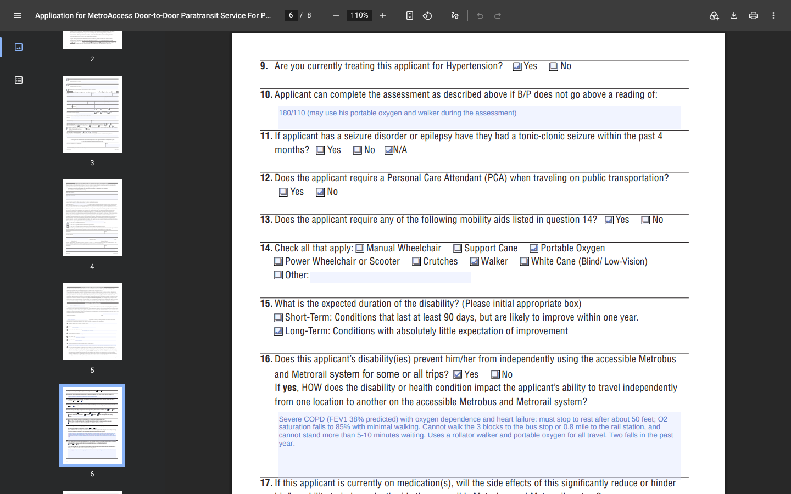
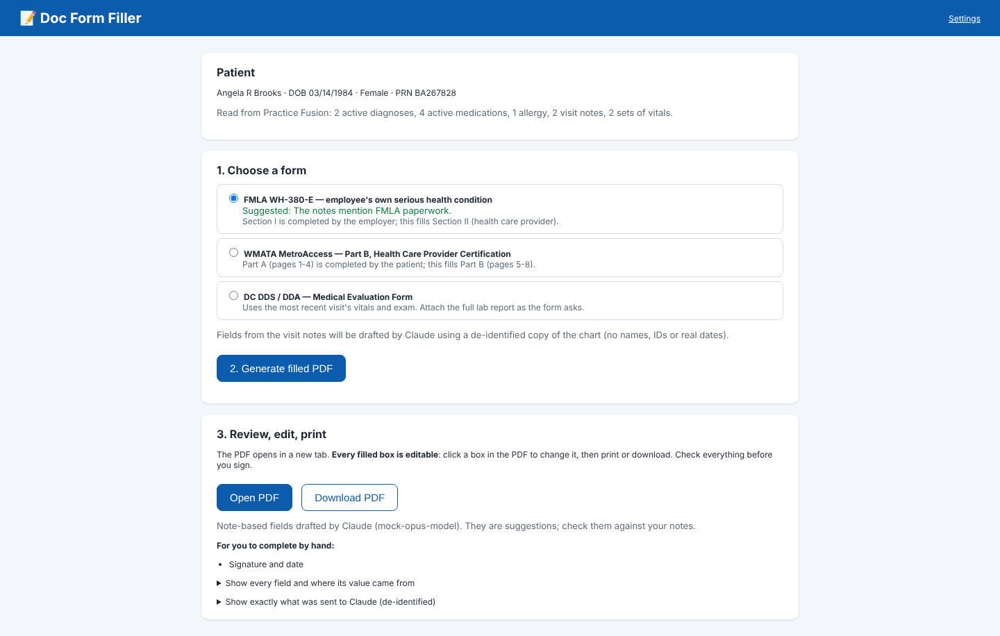
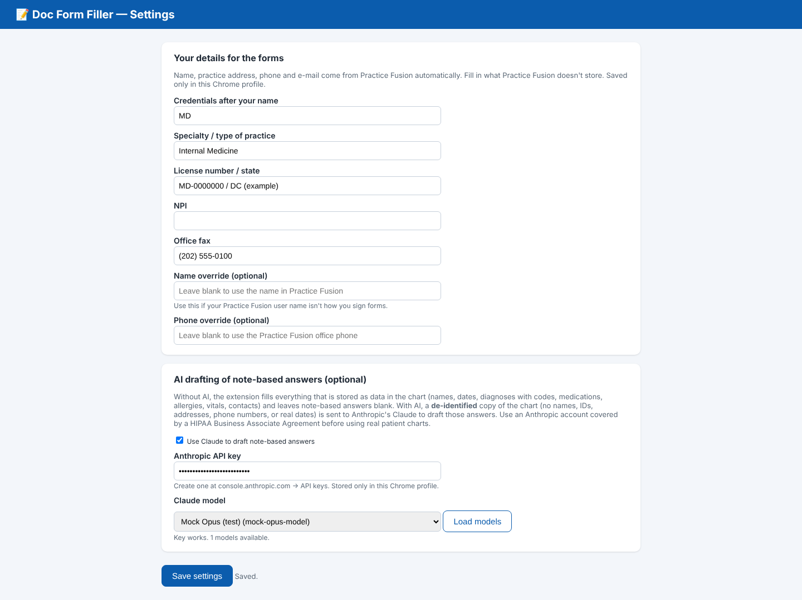

# Doc Form Filler

A Chrome extension that pre-fills a doctor's paperwork from the patient chart that is **already open in Practice Fusion**:

| Form | Who it's for | Pages filled |
|---|---|---|
| **FMLA WH-380-E** (U.S. Dept. of Labor) | Employee's own serious health condition | Section II, pages 2–4 |
| **WMATA MetroAccess, Part B** | Paratransit eligibility, health care provider certification | Part B, pages 5–8 |
| **DC DDS / DDA Medical Evaluation Form** | Annual physical / intake for DC Developmental Disabilities Administration | All 4 pages |

The doctor opens a chart, clicks **📝 Fill a form**, picks the form, and gets a draft PDF. **Every value in the PDF is an editable field**, so the doctor can change anything, then print and sign.

- Things stored as data in the chart are copied straight in: name, DOB, diagnoses with ICD-10 codes, medications, allergies, vitals, guardian/next of kin, and the practice's name, address and phone.
- Answers that live only in the visit notes can optionally be drafted by Claude (Anthropic's AI). Examples: "off work 10/06–11/30", "needs a walker and portable oxygen", the exam findings.
- Before anything is sent to Claude, the chart is **de-identified on the doctor's computer**: names, IDs, phone numbers and addresses are removed, and dates are shifted.
- Without an AI key, nothing leaves the computer, and the note-based boxes are left blank to type into.

> ⚠️ Drafts only. The doctor must review every field before signing. The extension never submits anything anywhere.

---

## Part 1 — For the doctor: everyday use

### Step 1. Log in to Practice Fusion in Chrome

1. Open **Google Chrome** (the same Chrome profile where the extension was installed, see Part 2).
2. Go to **https://static.practicefusion.com/apps/ehr/index.html**. You can also go to practicefusion.com and click **Log in**.
3. Enter your Practice Fusion **email** and **password** and click **Log in**.
4. If Practice Fusion says *"We don't recognize this browser"*:
   1. Leave **Text** selected and click **Send code**.
   2. Type the code from your phone.
   3. Keep **"Always trust this browser"** checked, so you aren't asked again on this computer.
   4. Click **Log in**.



### Step 2. Open the patient's chart

1. In the black menu on the left, click **Charts**.
2. Find the patient: type the name, phone, DOB or PRN in the search boxes at the top, or pick them from the **Recent** list.
3. Click the patient's name. The chart opens on the **Summary** tab.

### Step 3. Click **📝 Fill a form**

In the blue bar with the patient's name, there is now a white **📝 Fill a form** button at the top right, directly above Practice Fusion's **Actions** button.
Clicking the extension's icon in Chrome's toolbar does the same thing.



### Step 4. Choose the form and click **Generate filled PDF**

1. A new tab called **Doc Form Filler** opens and reads the chart in about a second. It shows the patient's name, DOB and PRN so you can confirm it's the right person.
2. Under **1. Choose a form**, the form that matches the chart is already selected and marked *Suggested*. For example, it picks FMLA when your note mentions FMLA. Pick a different one if needed.
3. Click **2. Generate filled PDF**. With AI turned on this takes a few seconds; without AI it's instant.



### Step 5. Review and edit the PDF, then print or save it

The filled PDF opens automatically in a new Chrome tab. If you close it, click **Open PDF** to reopen it, or **Download PDF** to save a copy.

- **Every filled box is editable.** Chrome shades the editable boxes light blue on screen; the shading doesn't print. Click into any text box and type to change it, or click a checkbox to tick or untick it. Press **Tab** to jump to the next box.
- Blank boxes are editable too. Type in anything the chart didn't have.
- To keep your edits, use the **download** icon (↓) in the PDF toolbar. If Chrome asks, choose **"With your changes"**. Or use the **printer** icon to print.
- Sign by hand (or as each form requires). Forms such as MetroAccess require an original signature.



Back on the **Doc Form Filler** tab, check:
- **"Left blank — not found in the chart"**: anything the tool couldn't fill. Fill these in the PDF if they apply.
- **"Show every field and where its value came from"**: every value and its source. *Practice Fusion chart* means copied from the chart, *Claude (from notes)* means AI-drafted, *Your settings* means from Settings.
- **"Show exactly what was sent to Claude"**: the de-identified copy of the chart, so you can see that no names or IDs left the computer.



### Tips that make the drafts better

The AI only uses what is written in your notes, and it leaves a box blank rather than guessing. When you expect a form, say the key facts in your plan. For example:
*"Off work 10/06–11/30; then 4 h/day light duty until 12/31; flare-ups up to 2x/month, 1–2 days each."*

---

## Part 2 — One-time setup: build, install and configure the extension

Whoever sets up the office computer does this once. It takes about 10 minutes.

### 2.1 What you need

- **Google Chrome**. Microsoft Edge also works; use `edge://extensions` instead of `chrome://extensions`.
- **Node.js 20 or newer**, used only to build the extension. Download the LTS version from https://nodejs.org.
- **git**, or download the repository as a ZIP from GitHub (green **Code** button → **Download ZIP**).

### 2.2 Build (compile) the extension

Open a terminal (Mac: Terminal; Windows: PowerShell) and run these one at a time:

```bash
git clone https://github.com/realpratikmathur/doc-form-filler.git
```

```bash
cd doc-form-filler
```

```bash
npm install
```

```bash
npm run build
```

`npm run build` does three things:
1. Bundles the JavaScript, including the PDF library and the Anthropic SDK, with esbuild.
2. Copies the extension's pages and icons.
3. Downloads the three blank forms from their official sites (dol.gov, wmata.com, dds.dc.gov) into the extension.

The finished extension is the **`dist`** folder. The last lines of the output say where it is.

> If a form download fails (sites sometimes block scripts), download the PDF in your browser from the URL printed in the error message. Save it into `.cache/forms/` with the file name shown, and run `npm run build` again.

### 2.3 Load it into Chrome

1. In Chrome's address bar type **`chrome://extensions`** and press Enter.
2. Turn on **Developer mode** with the switch in the top-right corner.
3. Click **Load unpacked** (top-left).
4. Select the **`dist`** folder inside `doc-form-filler` and click **Select**.
5. **Doc Form Filler** appears in the list. Make sure its switch is **on** (blue).
6. Pin it to the toolbar: click the **puzzle-piece** icon to the right of the address bar, then the **pin** next to *Doc Form Filler*.
7. If Practice Fusion was already open in a tab, **reload that tab** (F5 or ⟳) so the button appears.

> Chrome may sometimes show a banner about developer-mode extensions. That's expected for an extension installed this way; keep it enabled.

**Updating later:**
1. In the `doc-form-filler` folder, run `git pull`, then `npm run build`.
2. On `chrome://extensions`, click the **reload** arrow (⟳) on the Doc Form Filler card.

### 2.4 Settings (once per computer)

Open Settings in any of these ways:
- Right-click the toolbar icon → **Options**.
- `chrome://extensions` → Doc Form Filler → **Details** → **Extension options**.
- The **Settings** link at the top-right of the Doc Form Filler tab.

**Your details for the forms.** Practice Fusion supplies the doctor's name, practice address, phone and e-mail automatically. Fill in what Practice Fusion doesn't store: credentials (MD), specialty, license number/state, NPI and fax.

**AI drafting (optional).**
1. Create an API key at **https://console.anthropic.com** → *API keys*.
2. Paste it into **Anthropic API key** and click **Load models**. The newest Opus model is selected by default.
3. Tick **Use Claude to draft note-based answers**.
4. Click **Save settings**.



> **Before using real patient charts with AI**, make sure your Anthropic account is covered by a **HIPAA Business Associate Agreement (BAA)**. The extension de-identifies the chart first, but automatic de-identification of free-text notes is never perfect; see *Privacy* below.

---

## Privacy and security: what leaves the computer

| Step | Where it happens | What is involved |
|---|---|---|
| Reading the chart | Inside the Practice Fusion tab, using your own logged-in session | The same requests Practice Fusion's screens make. Nothing is stored. |
| Filling the PDF | Inside Chrome on this computer | The blank form plus chart data. Nothing is uploaded. |
| AI drafting (only if turned on) | Anthropic's Claude API, called directly from Chrome | A **de-identified** copy of the chart and the form's question list |

De-identification (`src/lib/deid.js`) happens on the computer before any AI call:
- The patient's, relatives' and guardian's names, the employer name, street address, phone numbers, e-mail, PRN, SSN and insurance/ID numbers are replaced with tokens like `[PATIENT]` and `[CONTACT_1]`.
- DOB becomes an age, and all full dates are shifted by a secret random number of days, so intervals still make sense.
- If any known identifier is still found in the text, **nothing is sent** and the note-based boxes stay blank.
- Claude's answers come back with tokens and shifted dates, which are swapped back on the computer.

Known limits:
- Doctor and facility names, and month/year-only dates (e.g. "03/2026"), stay in the text.
- Any identifier typed into free text in an unusual form may not be recognized.

Hence the BAA recommendation.

Other notes:
- The API key and settings are stored only in this Chrome profile (`chrome.storage.local`).
- The extension only has access to `static.practicefusion.com` (to read the open chart) and `api.anthropic.com` (only when AI is on).
- The extension uses Practice Fusion's own, **undocumented** web endpoints, the same ones its screens use. A future Practice Fusion update could break reading the chart until the extension is updated. Check Practice Fusion's terms of use for your practice.

---

## Troubleshooting

| Problem | Fix |
|---|---|
| No **📝 Fill a form** button | It only appears on a patient's chart, where the address contains `/charts/patients/`. Reload the Practice Fusion tab after installing or updating. Check the extension is switched on in `chrome://extensions`. |
| "Practice Fusion says you are not logged in" | Your session timed out. Log in again in the Practice Fusion tab, reopen the chart, and click the button again. |
| "Could not read the Practice Fusion tab" | Keep the Practice Fusion chart tab open while the filler tab works. Click the button again from the chart. |
| "Claude was not used: …" | The message says why: bad key, model not found, rate limit, or Claude declining. The PDF is still made with the chart-based fields; fill the rest by hand or try again. |
| Text looks too small in a box | The tool shrinks long answers to fit. Click the box in the PDF and shorten the text. |
| The DOL/WMATA/DDS publishes a new version of a form | Positions on flat forms are measured for the current versions (WH-380-E rev. June 2020; MetroAccess 50.295 05/24; DDS Medical Evaluation). A new layout needs the coordinates in `src/forms/*.js` updated. |

---

## For developers

```
src/
  manifest.json        Chrome extension manifest (MV3)
  content.js/.css      adds the "Fill a form" button inside Practice Fusion
  background.js        opens the filler tab for the current chart
  app.html/.js/.css    the filler tab (read chart → choose form → generate → review)
  options.html/.js     settings page
  lib/extract.js       reads the chart (runs inside the Practice Fusion tab)
  lib/deid.js          de-identify / re-identify
  lib/ai.js            Claude call (Anthropic TypeScript SDK, JSON-schema structured output)
  lib/pdf.js           fills existing PDF fields or adds new editable fields on flat PDFs
  lib/pipeline.js      chart → de-identify → Claude → re-identify → PDF
  forms/*.js           one module per form: AI questions, suggestion rule, field positions
scripts/build.mjs      esbuild bundle + copy + download blank forms → dist/
dev/test-fill.mjs      offline test with synthetic charts (npm test)
dev/e2e.mjs            end-to-end test in Chromium against a Practice Fusion test account
dev/fixtures/          synthetic charts and canned AI answers (all fake)
dev/seed/              creates the synthetic test patients in a Practice Fusion test account
dev/pf-session.mjs     shared Practice Fusion login helper for the dev scripts
```

Run the offline test. It fills every form from the synthetic charts with and without AI, then checks four things: no identifiers reach the AI, the schema is valid, real dates are restored, and every field is editable.

```bash
npm run build && npm test
```

The end-to-end test loads the built extension into Chromium, logs in to a Practice Fusion **test** account, opens the synthetic patients, clicks the button, and generates each form with the Claude API **mocked**. It needs Playwright (`npm i -D playwright && npx playwright install chromium`).

```bash
PF_EMAIL=you@example.com PF_PASSWORD='…' npm run e2e
```

If Practice Fusion asks for a texted code, the test sends it and waits for you to put the code into `.cache/pf-code.txt`. `PF_PROFILE_DIR` keeps a browser profile, so "trust this browser" sticks between runs.

To create the four synthetic test patients (all fake) in a Practice Fusion **test** account, run the command below. It is safe to re-run: existing items are skipped. Never run it against a practice with real patients.

```bash
PF_EMAIL=you@example.com PF_PASSWORD='…' node dev/seed/seed.mjs
```

**Adding a form:**
1. Copy `src/forms/fmla-wh380e.js` (for a PDF that already has fillable fields) or `src/forms/metroaccess.js` (for a flat PDF; place fields by PDF coordinates in points from the bottom-left corner).
2. Define the questions for the AI in `aiFields`.
3. Register the module in `src/forms/index.js`.
4. Add a fixture in `dev/fixtures/ai/` and a case in `dev/test-fill.mjs`.
